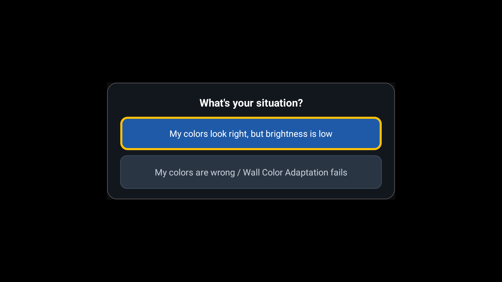
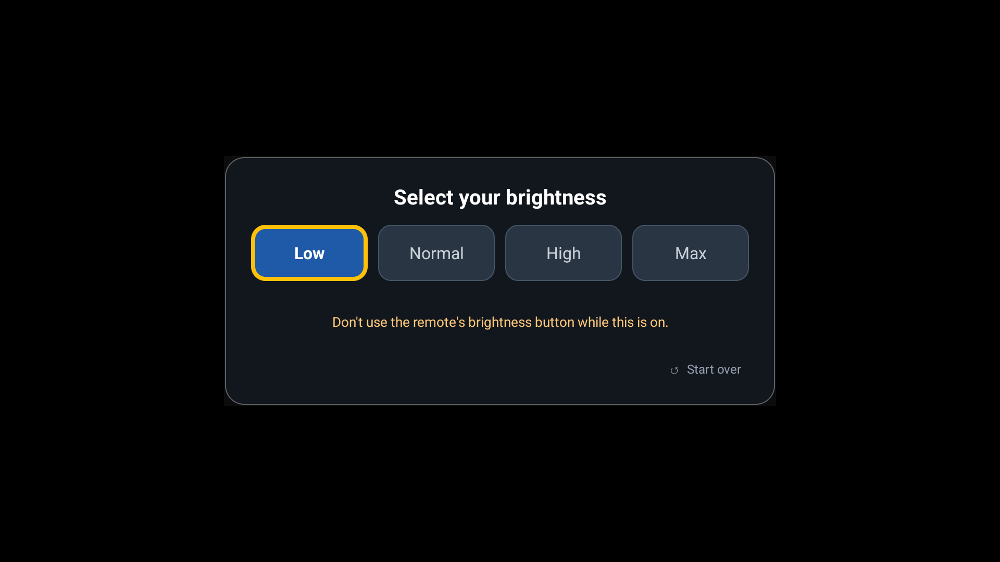
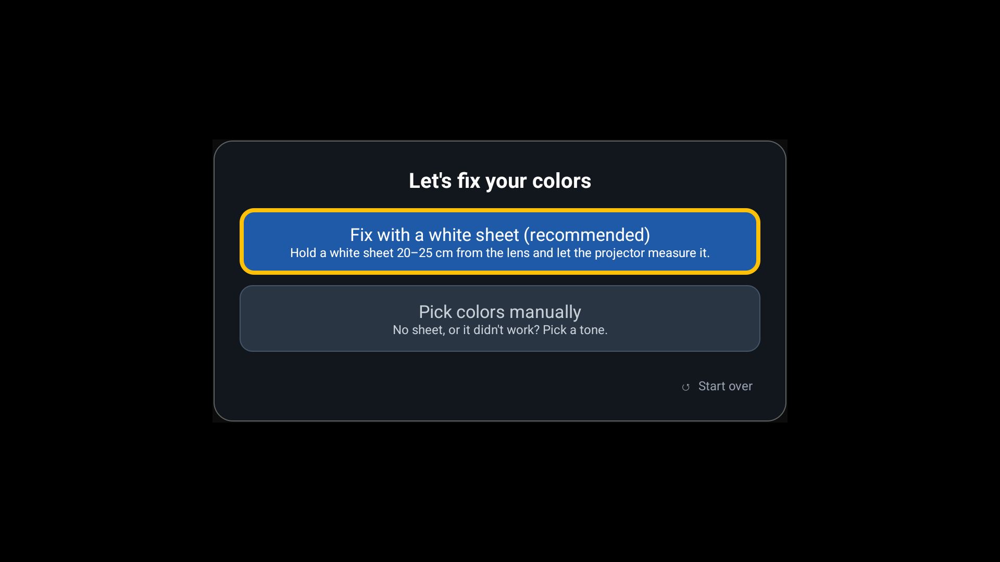
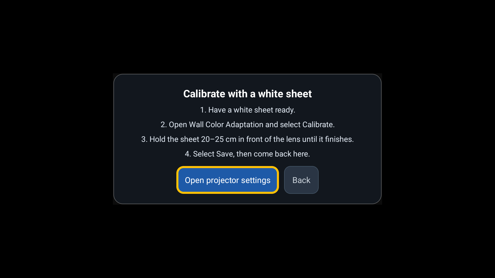
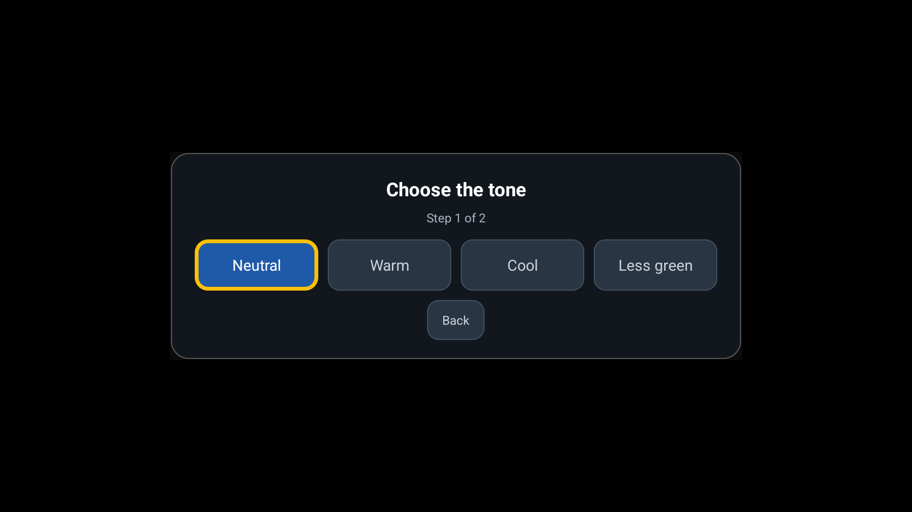
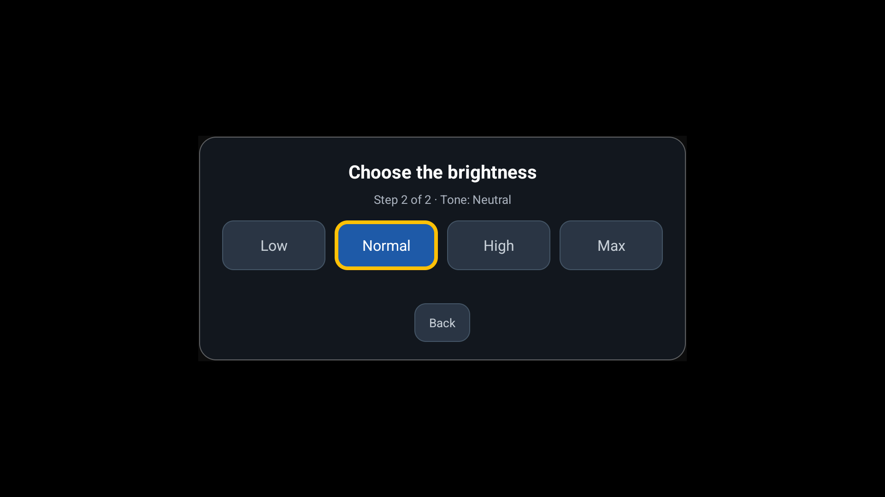
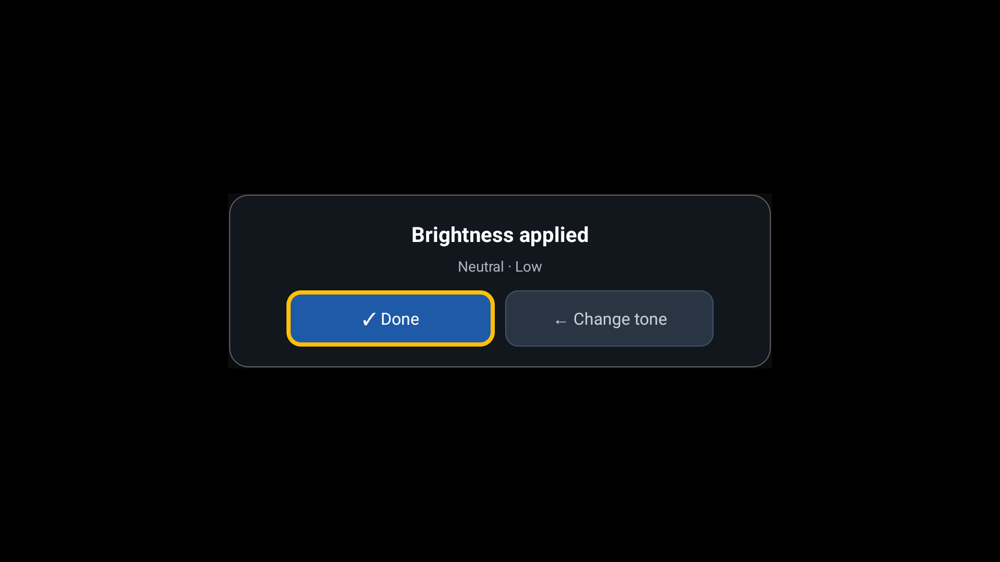

# Bright WCA

Keeps your Wall Color Adaptation colors while raising brightness on Anker projectors. Tested on Cosmos 4K SE, firmware V14.

## Install
Sideload `bright-wca.apk` (from Releases) onto the projector.

## First run
Turn on **Wireless debugging** once (Developer options). The app grants itself the permission it needs; you can turn debugging off afterwards.

## Modes
- **A – Brightness:** keep your current colors, pick Low / Normal / High / Max.
- **B – Fix colors:** calibrate with a white sheet, or pick a tone and brightness by hand.

## Screenshots
| | |
|---|---|
|  |  |
|  |  |
|  |  |
|  | |

## Disclaimer
Unofficial. Use at your own risk. Not affiliated with or endorsed by Anker.

## License
MIT. `native/spake2` (SPAKE2 pairing) is LGPL-3.0, see its LICENSE.

---

## Español
Mantiene los colores de Wall Color Adaptation y sube el brillo en proyectores Anker. Probado en Cosmos 4K SE, firmware V14.

- **Instalar:** instala el APK manualmente (sideload).
- **Primera vez:** activa **Depuración inalámbrica** una vez; la app se da el permiso sola.
- **Modos:** A sube el brillo sin cambiar colores; B ajusta colores con hoja blanca o a mano.
- **Aviso:** no oficial, úsala bajo tu propio riesgo, sin relación con Anker.
